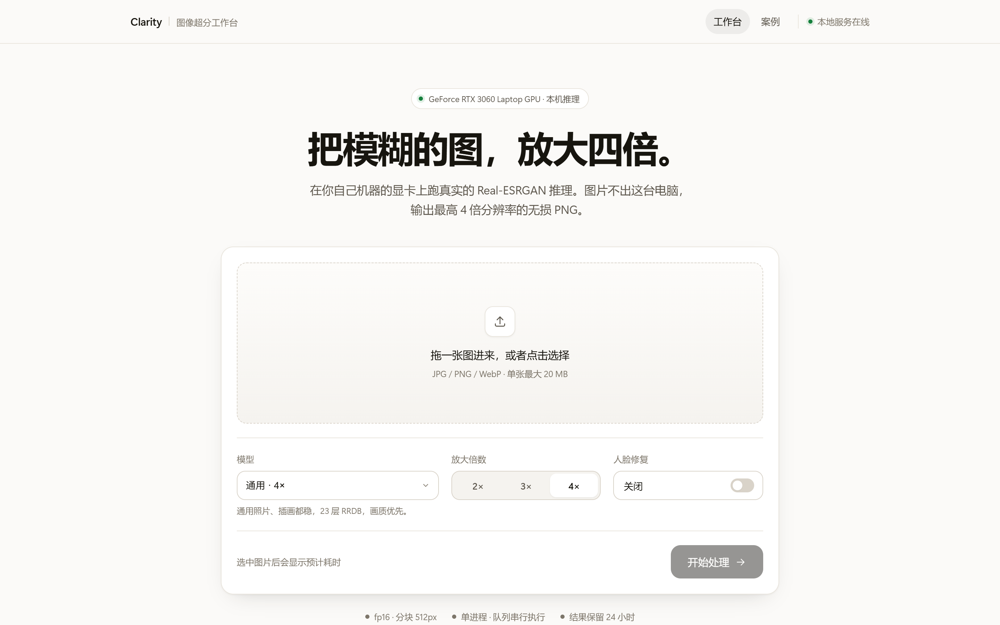
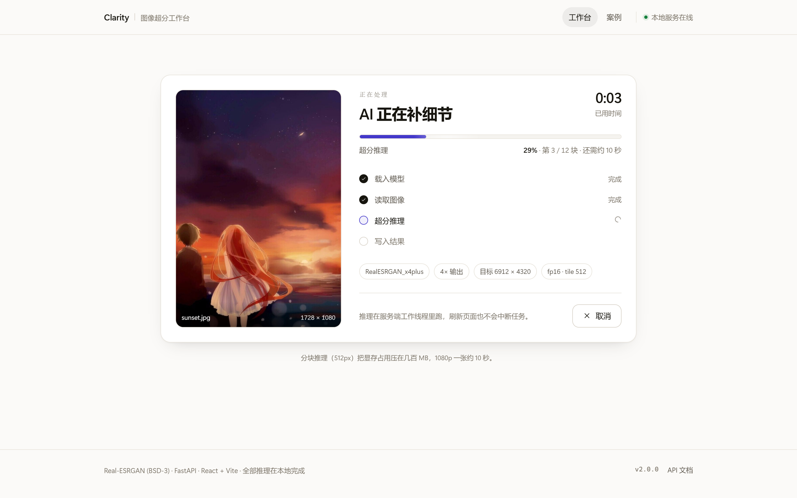
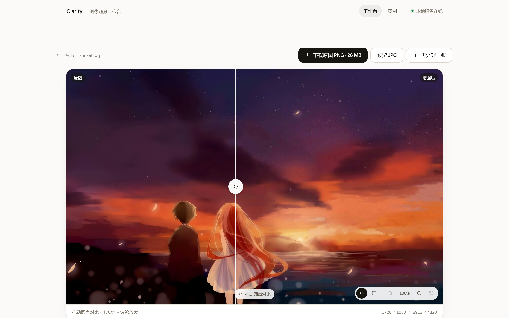
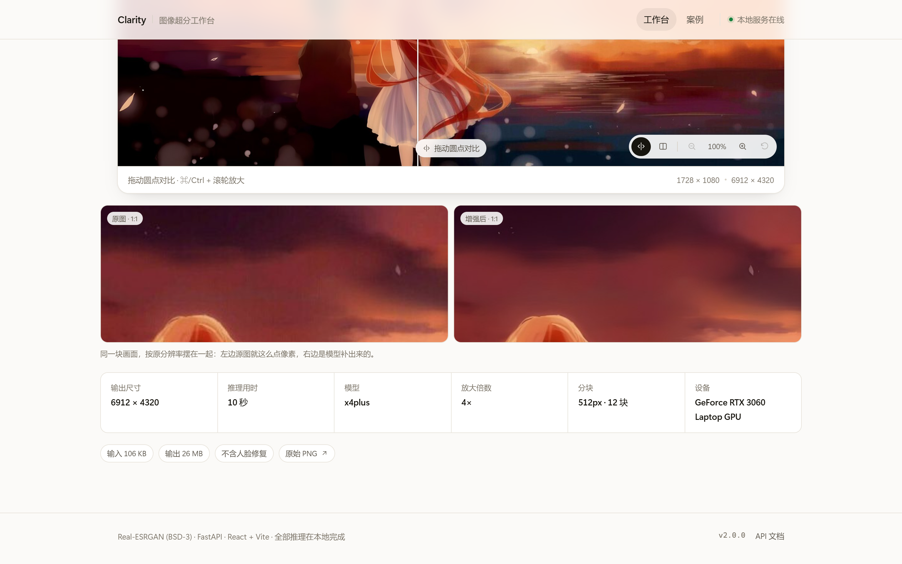

# Clarity · 本地图像超分工作台

把一张图放大四倍——真的加载模型、真的推理、真的产出 6912×4320 的 PNG。
推理跑在你自己机器的显卡上，一条命令起服务，界面和接口在同一个端口。



<table>
  <tr>
    <td width="50%"></td>
    <td width="50%"></td>
  </tr>
  <tr>
    <td align="center"><sub>处理中 · 12 个分块的真实进度、剩余时间、当前阶段</sub></td>
    <td align="center"><sub>结果 · 同一块区域左右对比，可缩放、可下载</sub></td>
  </tr>
</table>



---

## 这台机器上的真实数字

| 项目 | 实测 |
| --- | --- |
| 1728×1080 → 6912×4320（x4plus，4×） | **10.0 秒**（12 个分块），输出 PNG 26 MB |
| 850×1327 → 3400×5308 | 5.6 秒（6 个分块） |
| 512×256 → 2048×1024 | 0.7 秒（1 个分块） |
| 同一张 1080p，不分块（`TILE_SIZE=0`） | 152.8 秒 |
| 分块 vs 整图结果差异 | PSNR **54.9 dB**、平均像素差 0.13/255（肉眼无差） |
| 推理期间接口最长响应 | **23 ms**（进度条是真的，不是动画） |

硬件：RTX 3060 Laptop（6 GB）、torch 2.3.1+cu121、fp16、`TILE_SIZE=512`。

> 一个反直觉的结论：**分块不是为了省显存，是为了快 15 倍。**
> 整图推理时 6 GB 显存放不下 1080p 的中间特征图，驱动开始往共享内存倒腾，
> 时间从 10 秒涨到 152 秒。切成 512px 的块之后速度回到线性区间。

---

## 快速开始

需要：Python 3.9–3.11、一张能跑 CUDA 的显卡（CPU 也能跑，只是慢）、Node 18+。

```bash
# 1) Python 侧：torch + Real-ESRGAN
conda create -n real-esrgan python=3.10 -y && conda activate real-esrgan
pip install torch torchvision --index-url https://download.pytorch.org/whl/cu121
git clone https://github.com/xinntao/Real-ESRGAN.git ../Real-ESRGAN
pip install -r backend/requirements.txt
pip install facexlib            # 可选：想用"人脸修复"才需要
export REALESRGAN_ROOT=$(cd ../Real-ESRGAN && pwd)   # Windows: $env:REALESRGAN_ROOT="E:\Real-ESRGAN"

# 2) 前端 + 起服务（一条命令，会自动构建前端）
cd frontend && npm install && cd ..
./start.sh            # Windows: .\start.ps1
```

打开 <http://127.0.0.1:8000>。首次使用某个模型时会自动下载权重（x4plus 约 64 MB）。

**关于 Real-ESRGAN 源码目录**：代码通过 `REALESRGAN_ROOT` 把仓库加入 `sys.path`，
所以 `basicsr` / `realesrgan` / `gfpgan` 都从这份源码导入，版本可控、不用装包。
如果你的环境里已经 `pip install realesrgan basicsr`，也可以把 `REALESRGAN_ROOT` 留空。

### 换一台机器要改的东西

全部集中在 `.env`（照 `.env.example` 复制一份即可），代码里没有任何绝对路径：

| 变量 | 作用 | 默认 |
| --- | --- | --- |
| `REALESRGAN_ROOT` | Real-ESRGAN 源码目录 | 自动在仓库同级 / `E:/` / `D:/` / `~/` 下找 |
| `DATA_DIR` | 上传、结果、临时文件 | `.data/`（仓库内） |
| `WEIGHTS_DIR` | 模型权重 | `$REALESRGAN_ROOT/weights` |
| `TILE_SIZE` | 分块边长，`0` = 整图 | `512` |
| `HALF_PRECISION` | fp16 | `1` |
| `MAX_UPLOAD_MB` | 单张上限 | `20` |
| `MAX_INPUT_PIXELS` | 输入像素上限 | `24_000_000` |
| `TASK_KEEP_HOURS` | 结果保留时长 | `24` |
| `PORT` / `HOST` | 监听地址 | `8000` / `127.0.0.1` |

命令行参数和环境变量都走同一套默认值，`python -m uvicorn app.main:app --app-dir backend` 也能直接起。

---

## 为什么是"本地应用"，不是"在线服务"

这不是偷懒，是算过账的：

- **云端跑不动**：Vercel 的 Serverless 给 Python 依赖 500 MB 空间，`torch` 一家就超了，而且没有 GPU。
  租一张带 GPU 的机器只为放进作品集，成本不合理。
- **浏览器内推理掉档**：WebGPU / WASM 跑量化模型确实能纯静态部署，但模型要么小一号、要么精度掉一截，
  访客点开看到又慢又糊的结果，比看不到链接更伤。
- **所以拆成两件事**：推理在本地（这个仓库的应用），线上只放**真实产物**（`#/cases` 页面）。

案例页里每一组对比图都是这个仓库的代码真实跑出来的，连耗时、分块数、输出体积都来自同一次任务
（`scripts/build_case_assets.py` 生成，不是手工填的）。

### 尝试过的取舍

| 方案 | 结论 |
| --- | --- |
| Vercel + Serverless 推理 | 不可行：依赖体积 + 无 GPU |
| 浏览器内 WebGPU 推理 | 可行但画质/速度双降，观感差 |
| 云 GPU 常驻服务 | 成本与自己用不成比例 |
| **本地应用 + 静态案例页** | 采用 |

---

## 这次改了什么

接手时核心推理是通的，问题全在工程和体验上。逐条：

| 原来的问题 | 现在的做法 |
| --- | --- |
| 参数完全不生效（前端发 JSON body，后端当 query 解析，body 被丢弃） | `/api/tasks` 用 Pydantic 模型接 body，`outscale` / `model` / `face_enhance` 都真的生效；冒烟测试里会断言输出尺寸 = 输入 × outscale |
| 结果页"原图"404（静态目录按启动目录挂载，文件却写在别处） | 路径统一由配置算出（绝对路径），结果文件通过 `/api/tasks/{id}/file/{kind}` 提供，前端不拼路径 |
| 推理写在 `async def` 里堵死事件循环，118 秒内轮询全挂起 | 推理放到独立工作线程，队列串行；进度按真实分块上报，轮询最长 23 ms |
| `npm run build` 失败（7 个未使用变量） | 全量重写前端，`tsc --noEmit` 零错误零警告 |
| 路径硬编码 `e:/Real-ESRGAN` | 全部走 `REALESRGAN_ROOT` + `.env`，找不到时给"缺什么、怎么装"的提示而不是崩 |
| 到处都是 `print("❌ …")`，GBK 控制台下 500 | 标准流切 UTF-8（`errors="replace"`）+ 统一 logging，不再有裸 print |
| 上传没有校验、没有 README / git / Docker | 类型白名单 + 体积 + 像素上限 + Pillow 真解码；有 README、有 git 历史、有 Dockerfile |
| （新发现）进度是假的：0→10→30→60→90 硬跳 | 按分块真实上报，带已完成块数、ETA、阶段 |
| （新发现）取消按钮不存在 | 分块之间检查取消标志，真的能中断 |
| （新发现）竖图会被容器裁掉 | 对比区跟随图片比例收缩，`object-fit: contain` + 绝对定位修掉百分比高度陷阱 |

---

## 结构

```
backend/
  app/
    config.py            # 所有路径与参数，只用环境变量 + 默认值
    main.py              # 应用装配、日志、静态托管（生产模式同端口）
    api/routes.py        # 上传校验、任务、文件、模型、健康检查
    services/engine.py   # 模型加载、分块推理（带进度钩子与取消）、设备信息
    services/tasks.py    # 单 worker 队列、真实进度、落盘（PNG + 预览 + 缩略图 + meta.json）
  requirements.txt
frontend/
  src/
    App.tsx              # 顶部导航 + 工作台/案例切换
    components/          # UploadView / ProcessView / ResultView / CompareSlider / DetailPeek / CasesPage
    lib/api.ts           # 接口类型与调用（URL 全部来自服务端）
    index.css            # 设计令牌 + 手写组件样式（不依赖 UI 框架）
  public/cases/          # 案例页素材（真实输出，脚本生成）
scripts/
  smoke_test.py          # 端到端冒烟：上传 → 排队 → 推理 → 取文件 → 校验 outscale
  api_check.py           # 接口约定：坏输入必须是 4xx + 人话
  build_case_assets.py   # 跑一组真实推理，生成案例页素材与数据
  shoot.mjs              # 用系统 Chrome（CDP，零依赖）拍作品集截图
samples/                 # 三张真实测试图，案例页就是它们跑出来的
```

## API

| 方法 | 路径 | 说明 |
| --- | --- | --- |
| `GET` | `/api/health` | 设备信息、队列长度、可调参数 |
| `GET` | `/api/models` | 模型列表（含是否已下载）、人脸修复可用性 |
| `POST` | `/api/uploads` | 上传（类型/体积/像素三重校验），返回 `file_id` 与宽高 |
| `POST` | `/api/tasks` | 创建任务，body：`{file_id, model, outscale, face_enhance}` |
| `GET` | `/api/tasks/{id}` | 状态：阶段、进度、`tiles_done/total`、ETA、耗时、输出元信息 |
| `POST` | `/api/tasks/{id}/cancel` | 取消（分块之间生效） |
| `GET` | `/api/tasks/{id}/file/{kind}` | `input` / `result` / `preview` / `thumbnail`，`?download=1` 附件下载 |
| `DELETE` | `/api/tasks/{id}` | 删除任务与文件 |

交互文档：<http://127.0.0.1:8000/docs>

## 开发与演示

```bash
./dev.ps1                 # 后端 reload + Vite HMR（前端 :3000，代理 /api）
./start.ps1 -Rebuild      # 生产模式：一个进程、一个端口，界面和接口一起
```

其它脚本：

```bash
python scripts/smoke_test.py --scale 2                    # 端到端冒烟测试
python scripts/build_case_assets.py --base http://127.0.0.1:8000   # 重新生成案例素材（会跑真实推理）
node scripts/shoot.mjs --image portrait.jpg --as portrait.jpg      # 拍作品集截图到 docs/screenshots
```

## Docker（可选，未在真实 GPU 上验证）

仓库里有 `Dockerfile`（CUDA 12.1 runtime + torch cu121 + 前端构建产物）。
本机 Docker 没有 GPU 直通，所以这份镜像只验证了写法、没有真跑起来过——
它是"换机器/上服务器"的参考起点，日常使用建议还是 `start.sh` / `start.ps1`。

```bash
docker build -t clarity .
docker run --gpus all -p 8000:8000 -v clarity-data:/data clarity
```

## 静态案例页（Vercel）

`#/cases` 是纯静态页面，只展示真实产物、不做推理：

```bash
cd frontend && npm run build:static    # 只打案例页
```

仓库根目录的 `vercel.json` 已经配好（构建 `frontend`、输出 `frontend/dist`）。
也可以直接在 Vercel 里把 **Root Directory** 设成 `frontend`、构建命令换成 `npm run build:static`。

## 已知限制

- **一次只跑一个任务**：单 worker 串行，`MAX_QUEUE=4` 之后直接拒绝。多人用需要换成任务队列 + 多卡调度。
- **任务状态在内存**：进程重启后历史任务消失（结果文件还在，24 小时后由清理逻辑删除）。
- **人脸修复需要额外权重**：装了 `gfpgan` 才会出现开关，首次使用下载 348 MB。
- **其它模型要联网下载**：`x4plus_anime_6B`、`x2plus`、`general-x4v3` 未预置，首次选择时下载。
- **GUI 只在本地**：没有账号、没有历史记录、没有并发隔离——这是刻意的，作品集要的是"能跑、能证明"，不是做一个 SaaS。

## 致谢与许可

- [Real-ESRGAN](https://github.com/xinntao/Real-ESRGAN)（BSD-3-Clause）与 [BasicSR](https://github.com/XPixelGroup/BasicSR)
- [GFPGAN](https://github.com/TencentARC/GFPGAN)（可选，人脸修复）
- 前端 React 18 + Vite 4，样式手写；后端 FastAPI + Pillow + OpenCV
